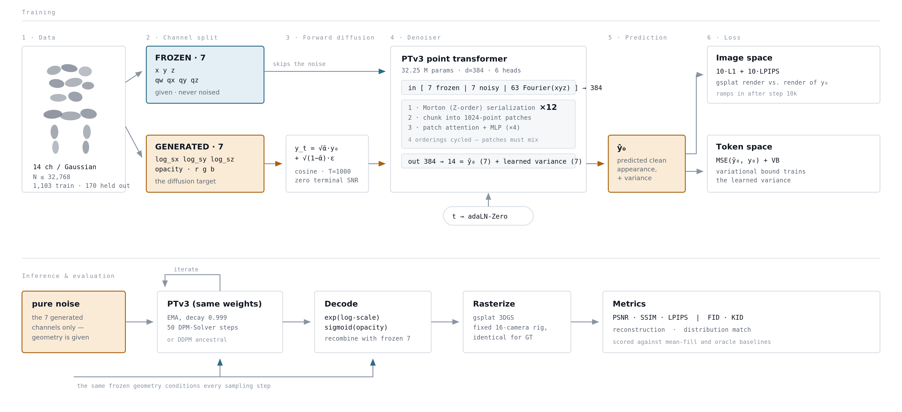
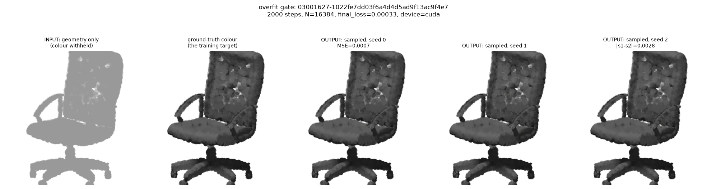
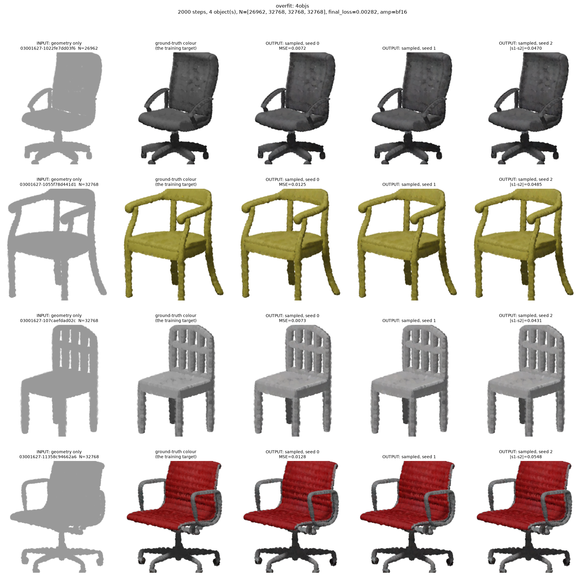
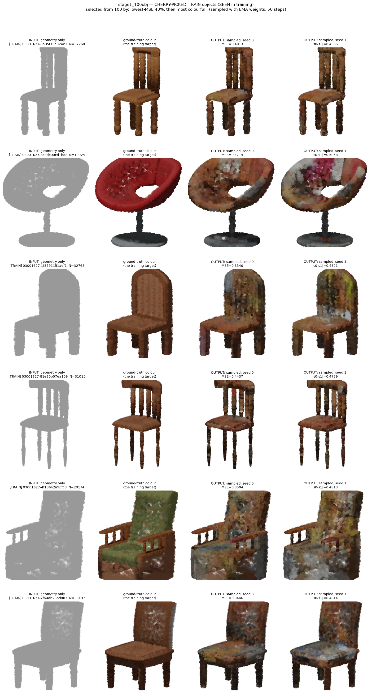
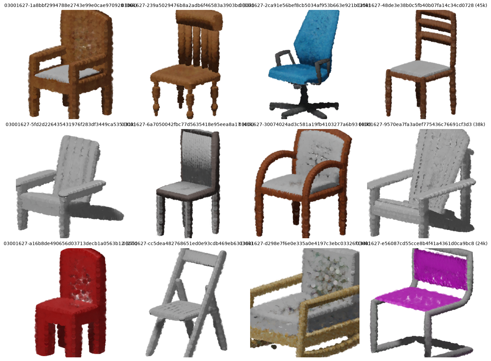
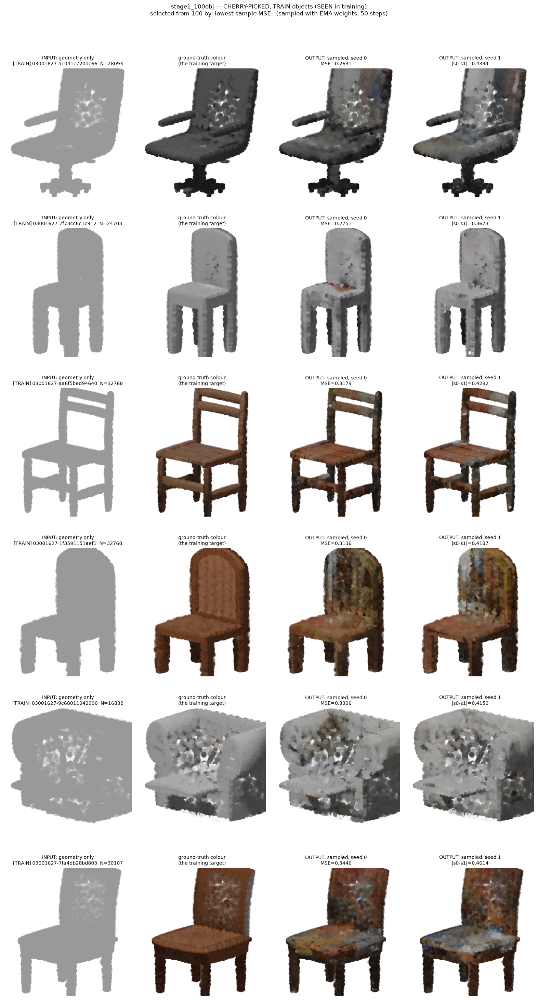
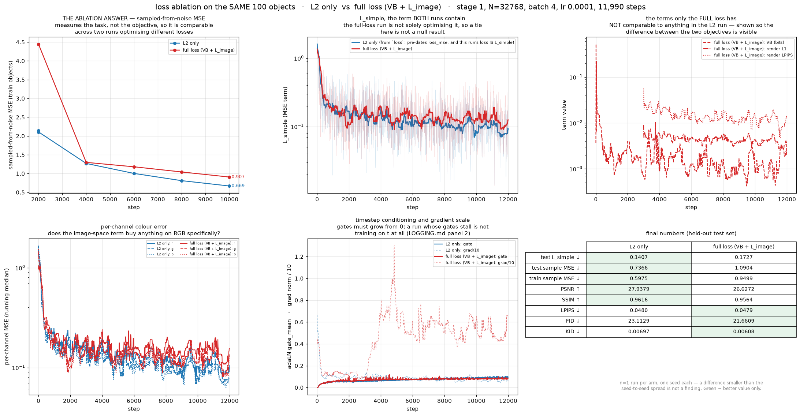
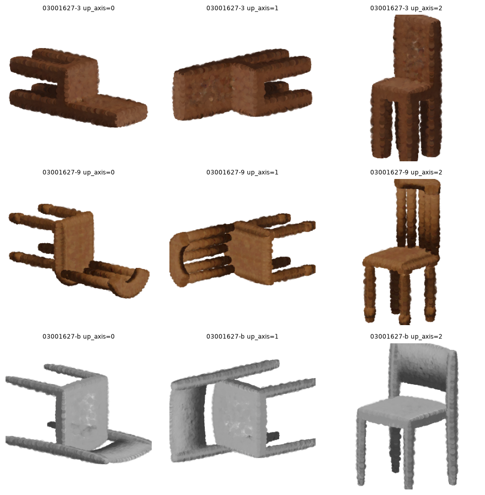
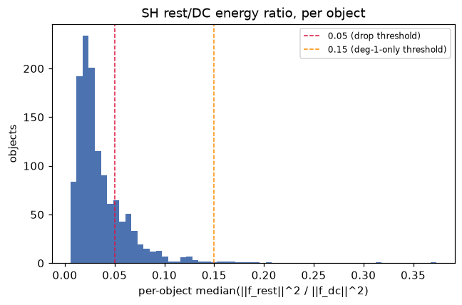

# Diffusion over 3D Gaussian Splats

**Generating the *appearance* of 3D Gaussian-Splat chairs with a point-transformer diffusion model — trained from scratch.**

Given the bare geometry of a chair (the positions and orientations of a few
thousand 3D Gaussians), the model diffuses in the *appearance* channels —
scale, opacity and colour — to paint a plausible, coherent chair. Everything
here was built from scratch during a 5-day [PSI:ML](https://psiml.pfe.rs/)
sprint: the data pipeline, an [EDM](https://github.com/NVlabs/edm)-style
diffusion setup, a [PointTransformerV3](https://github.com/Pointcept/PointTransformerV3)-style
backbone adapted to splat tokens, a differentiable 3DGS render loss, and the
evaluation harness.



---

## What this is

3D Gaussian Splatting represents an object as a cloud of oriented, coloured
3D Gaussians. Each Gaussian carries a **14-channel** token:

| Group | Channels | Role |
|---|---|---|
| **Frozen geometry** (7) | `x y z`, quaternion `qw qx qy qz` | given as conditioning — never noised |
| **Generated appearance** (7) | `log_sx log_sy log_sz`, `opacity`, `r g b` | the diffusion target |

The task is **geometry-conditioned appearance synthesis**: the network sees the
frozen geometry every sampling step and denoises the seven appearance channels
from pure noise into a consistent chair. This started life as *unconditional*
generation and was staged down to appearance-only synthesis to get a clean,
debuggable signal first.

**Dataset.** [ShapeSplatsV1](https://huggingface.co/datasets/ShapeNet/ShapeSplatsV1),
synset `03001627` (chairs) — **1,273 objects** total (a hard ceiling; only the
`_0`/`_1` shards exist on HuggingFace), split **1,103 train / 170 val**, seed 0,
written to disk once and never regenerated.

**Hardware.** A single NVIDIA **A100-40GB** inside a shared Jupyter container.

---

## Method at a glance

- **Backbone** — a *flat* PTv3-style point transformer (`model/ptv3.py`),
  **32.25 M** params (depth 12, `d_model` 384, 6 heads, patch size 1024,
  MLP ratio 4). No dense `(B, N, C)` tensor exists anywhere: points from every
  object in a batch are concatenated into `(total_N, C)` with an `offset`
  array marking object boundaries. That flat layout is what makes variable-N
  batching possible — and is exactly what caused the performance bug in
  [§ The 28× fix](#the-28-performance-fix).
- **Serialization** — points are ordered by **Morton (Z-order)** curve, chunked
  into 1024-point patches, and attention runs within patches. Morton ordering
  gives ~17× tighter adjacent-point locality than a random permutation.
- **Conditioning** — **AdaLN-Zero** on the diffusion timestep `t`; the frozen
  geometry (raw + Fourier-encoded xyz) is concatenated to the input.
- **Diffusion** — cosine schedule (`squaredcos_cap_v2`), **predict-`y₀`**
  (`prediction_type="sample"`), `T=1000`, **zero-terminal-SNR**. Sampling uses
  a 50-step DPM-Solver (with a DDPM ancestral option for comparison).
- **Loss** — `L_simple`, unweighted MSE on the predicted clean tokens, plus an
  **optional differentiable render loss** (`10·L1 + 10·LPIPS` on gsplat
  renders) that ramps in after step 10k.
- **EMA** weights (decay 0.999), fp32 master weights, **bf16** autocast for the
  training forward, fp32 sampling.

---

## Results

Every number below comes from a script in this repo that can be re-run.

### The overfit gates — does the machinery actually learn?

The single most important checkpoint: if the model can't memorize one object,
nothing downstream matters. Two checks define a pass — **check 7** (final
training loss) and **check 8** (the *sampler*, run from pure noise for 50 steps,
reproduces the object; this catches a train/sample schedule mismatch that the
loss alone cannot see).

| Run | N | Precision | Check 7 (loss) | Check 8 (sample MSE) |
|---|---|---|---|---|
| `overfit1_stage1_16k` (gate of record) | 16,384 | fp32 | **0.00033** | **0.00070** |
| `overfit_32k_2000` | 32,768 | bf16 | 0.00068 | 0.00102 |
| `overfit_4obj_32k` (4 distinct chairs) | 32,768 | bf16 | 0.00282 | 0.01009 |

The 16k gate drops the loss **2,700×** (0.894 → 0.00033); the AdaLN gate
magnitude grows 0 → 0.116, proving `t` genuinely reaches the network. The
4-object run keeps genuinely mixed lengths (`[26962, 32768, 32768, 32768]`) so
the variable-N path is live in every step.

| Single-object gate (16k) | Four objects, mixed lengths |
|---|---|
|  |  |

### Geometry → appearance on held-out selections

Given geometry only (grey), the model paints colour and material. Left to right:
input geometry · ground-truth colour · two independent samples.



### Noise → chair, across the sampling trajectory



---

## The 28× performance fix

The most instructive part of the project. At bring-up, a 32 M-param model was
running **1033 ms/step** on an A100 — 4–20× too slow — and using 8 GB at batch
**1**. Three plausible hypotheses (non-contiguous q/k/v, SDPA falling back to
the math backend, "switch to flash attention") were **all wrong** and all cheap
to *believe* but expensive to *act on*. The profiler found the real cause in one
shot, and it was one line of our own code:

```python
shift1 = shift1[batch_idx]   # (B, dim) per-object -> (total_N, dim) per-point
```

`indexing_backward_kernel` was **89% of the fp32 step / 97% of the bf16 step**.
The backward of an indexed read is an atomic scatter-add of `total_N` rows into
`B` rows — at `B=1`, every thread contends for a single address. The flat layout
that enables variable-N batching is what put a `[batch_idx]` broadcast inside
every one of the 12 blocks. Replacing it with plain broadcasting (whose backward
is a `sum` reduction, no atomics), verified bit-identical:

| | before | after | speedup |
|---|---|---|---|
| fp32 step | 2056 ms | **221 ms** | 9.3× |
| bf16 step | 2952 ms | **104 ms** | **28×** |
| GPU memory (bf16) | 15.7 GB | **8.4 GB** | 1.9× less |

An epoch over 1,103 objects dropped from **~40 min to ~2 min**, and batch-4 ×
32k became viable *without* gradient checkpointing. A bonus lesson: before the
fix, bf16 was *slower* than fp32 — the bottleneck had inverted the ranking of
every optimization measured around it. **Fix the bottleneck first, then
re-measure what you already rejected.**

---

## Experiments & honest limitations

- **Colour collapse.** The model reliably recovers *structure* and *material*,
  but tends to **average hue toward brown** rather than commit to a vivid
  colour — a red chair samples as muddy brown-red. This was diagnosed, not
  hidden: the mechanism is the model regressing to the conditional mean of
  colour given geometry. See the cherry-pick and colour-transfer figures below.
- **Ablations** — `stage1_100obj` vs a larger-capacity variant, with loss
  curves (`figures/ablation_*.png`, `figures/curves_*.png`).
- **Colour transfer** — steering the appearance of one chair toward the palette
  of another (`figures/colour_transfer_brown12.png`).

| Cherry-picked (train) | Ablation curves |
|---|---|
|  |  |

---

## Repository layout

```
.
├── model/              # PTv3-style backbone, denoiser, AdaLN-Zero conditioning
├── diffusion/          # noise schedule, losses, differentiable render loss, sampling
├── data/               # shard dataset, augmentation
├── train/              # training loop, overfit gate, EMA, checkpoint, logging
├── eval/               # metrics (PSNR/SSIM/LPIPS), gsplat 3D render, render grids
├── experiments/        # ablations, colour transfer, reconstruction grids, selection
├── analysis/           # diagnostic probes (why-grey, SNR, receptive field, seed spread)
│
├── preprocessing.py    # normalize → FPS subsample → tokenize → standardize
├── build_shards.py     # orchestrates preprocessing over the full dataset into a memmap
├── splat_utils.py      # 3DGS .ply loader (+ CPU point renderer) — reused everywhere
├── stage_config.py     # the training/model configuration dataclass
├── batching.py         # the flat (total_N, C) + offset batching primitives
├── ptv3.py             # earlier standalone backbone (bring-up / smoke tests)
│
├── check_*.py          # per-stage self-checks (dataset, denoiser, schedule, losses…)
├── bench_*.py          # the profiling harness behind the 28× fix
├── health_check.py     # the seven numbers that say whether a run is going well
├── watch_run.py        # live, read-only tail of a run's stats.jsonl
│
├── eda/                # exploratory phase — a pure-numpy 3DGS toolkit + notebooks
└── figures/            # curated figures used in this README
```

### The `.ply` loader — read this before touching data

`splat_utils.py` (and `eda/splatlib.py`) already handle the three things that
silently corrupt naive 3DGS loaders: **opacity is a logit** (sigmoid it),
**scale is a log** (exp it), and the **quaternion is w-first and unnormalized**.
Verify any new loader by building the covariance from `(scale, quaternion)` and
confirming its eigenvalues equal `scale²` — that one check catches both.

---

## Getting started

### 1. Environment

```bash
python -m venv .venv && source .venv/bin/activate   # or conda
pip install -r requirements.txt
```

Trained on Python 3.11, torch 2.11 + CUDA 12.8. `gsplat` and `wandb` are
optional — there is a CPU point-renderer fallback, and W&B logs offline if it
isn't authenticated (`stats.jsonl` is always written regardless).

### 2. Data

Download the ShapeSplatsV1 chair shards (`03001627_0.zip`, `03001627_1.zip`)
from [HuggingFace](https://huggingface.co/datasets/ShapeNet/ShapeSplatsV1)
(gated — accept the terms and `hf auth login` first), extract them, then build
the preprocessed shards:

```bash
python build_shards.py     # normalize → FPS → tokenize → standardize → tokens.dat
```

This writes `tokens.dat`, the train/val `split.json`, and the saved channel
statistics. Point the config at wherever you extracted the `.ply` files.

### 3. Sanity checks (run these before training)

```bash
python check_ptv3_stage.py       # forward/backward, serialization locality & round-trip
python check_denoiser_stage.py   # AdaLN-Zero init, variable-N batching equivalence
python check_schedule_stage.py   # zero-terminal-SNR
```

### 4. The overfit gate — the checkpoint that matters most

```bash
# gate of record (fp32, 16k, ~34 min)
python train/overfit.py --n-gaussians 16384 --steps 2000 --run-name overfit1_stage1_16k

# fast config (bf16, 32k, ~3.5 min)
python train/overfit.py --n-gaussians 32768 --steps 2000 --amp bf16 --run-name overfit_32k_2000

# four distinct chairs, mixed lengths (~13 min)
python train/overfit.py --n-objects 4 --n-gaussians 32768 --steps 2000 --amp bf16 --run-name overfit_4obj_32k
```

Each run writes `runs/<name>/config.json`, per-step `runs/<name>/stats.jsonl`,
and a checkpoint. `watch_run.py` tails the stats live and is safe to run against
an in-flight process.

### 5. Full training & evaluation

```bash
python train/loop.py                 # full run: augmentation, EMA 0.999, render loss
python eval/image_eval.py --sampler dpm   # PSNR / SSIM / LPIPS against ground truth
python eval/render_grid.py                # noise → chair render grids
bash experiments/run_all.sh               # ablations, colour transfer, reconstruction
```

### 6. Profiling (reproduce the 28× fix)

```bash
python bench_model.py --n-gaussians 32768               # fp32
python bench_model.py --n-gaussians 32768 --amp bf16    # bf16
python bench_attention.py                               # which SDPA backend is live
```

---

## Exploratory analysis

The `eda/` folder holds the first pass: **`splatlib.py`**, a dependency-light
(numpy + plyfile) 3DGS toolkit that loads, renders, and analyzes splats entirely
on CPU so you can iterate in a notebook — plus the notebooks that established the
key data facts:

- The chairs' up-axis is **z**, not y (a bug that put every chair on its back —
  caught by rendering all three candidate axes before trusting any figure, and
  cross-confirmed by raw bounding-box extents).
- The **f_rest** (view-dependent) SH energy is < 5% of the DC term, so it was
  dropped: 59 channels → 14.
- The mirror-symmetry axis was found empirically (reflect-and-score self-similarity).

| Up-axis check | SH energy ratio |
|---|---|
|  |  |

---

## Project story

This was a 2-person, 5-day sprint under real cluster constraints (a shared
A100 quota, a 64 MB `/dev/shm` that crashes multi-worker DataLoaders, no display
node). The working philosophy throughout:

1. **Every step ships with a check it can run itself** — "looks done" is not a
   stopping condition.
2. **The visual criterion is the real gate** — a loss of 0.0003 is a diagnostic;
   "the dark grey chair renders as a dark grey chair" is the pass/fail call.
3. **Profile before optimizing** — see the 28× fix.

---

## Credits

Built by **Miloš Nikolić** (and teammate) for **PSI:ML** (Petnica School of
Machine Learning), 2025. Backbone adapted from
[PointTransformerV3](https://github.com/Pointcept/PointTransformerV3);
diffusion preconditioning informed by [NVlabs/edm](https://github.com/NVlabs/edm)
and GaussianCube. Data: [ShapeSplatsV1](https://huggingface.co/datasets/ShapeNet/ShapeSplatsV1).

Released under the [MIT License](LICENSE).
